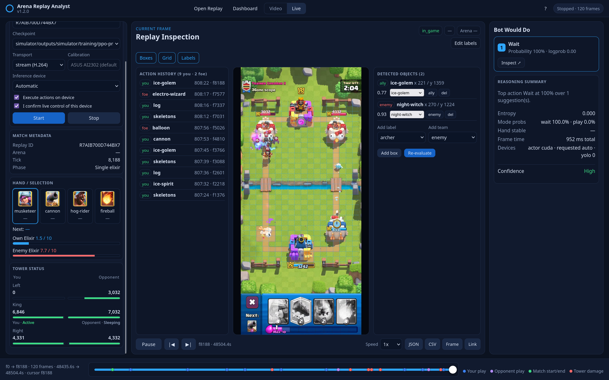
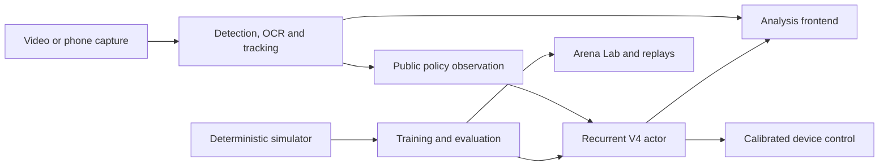

# Clash Royale RL Bot

Computer vision, public-state tracking, a deterministic battle simulator, and
policy-learning tools for Clash Royale. The browser applications support
recorded-video analysis, live phone observation, policy inspection, and
simulator replay.

**[Current goal and status](STATUS.md)** is the single place for the selected
policy, measured results, remaining work, and evidence limits.
[Documentation](docs/README.md) separates reusable workflows, design notes,
and dated experiments.



## Setup

Use Python 3.12 and the pinned KataCR submodule:

```bash
git clone https://github.com/Keschler/cr-bot.git
cd cr-bot
git submodule update --init vendor/external/KataCR
python3.12 -m venv outputs/venv
source outputs/venv/bin/activate
python -m pip install --upgrade pip
pip install -e .
```

Dependencies are declared in `requirements.txt` and loaded by
`pyproject.toml`. Local environments and generated artifacts live under
`outputs/`. Detector/classifier assets and policy checkpoints are required
for analysis; heavy dependencies load when analysis starts.

## Applications and commands

| Purpose | Entry point | Guide |
|---|---|---|
| Video analysis and live phone workspace | `uvicorn src.frontend.server:app --reload` | [Frontend](src/frontend/README.md) |
| Simulator arena, training views and evaluation playback | `PYTHONPATH=.:src python -m sim_viewer` | [Arena Lab](src/sim_viewer/README.md) |
| Vision/tracking CLI | `cr-bot --help` | [Action evaluation](docs/eval/README.md) |
| V4 training and evaluation | Scripts under `scripts/run_v4_*.py` | [Training workflow](docs/workflows/v4_training.md) |
| Replay correction experiments | `python scripts/run_v4_replay_corrections.py --help` | [Correction workflow](docs/workflows/v4_replay_corrections.md) |
| Standalone live/video policy runner | `python simulator/run_prototype_live.py --help` | [Live runner and packaging](simulator/RUN_PROTOTYPE_LIVE.md) |
| Controlled two-phone measurements | `PYTHONPATH=.:src python -m simulator lab --help` | [Physical lab](simulator/physical_lab/README.md) |

Run commands from the repository root with `outputs/venv/` activated. The
frontend uses native JavaScript modules and requires no Node build or npm
dependencies.

### Analyze video or observe a phone

Start the frontend and open **http://127.0.0.1:8000/**. Choose **Video** to
upload a recording, or **Live** to select an explicitly identified ADB device.
Choose a compatible V4 checkpoint in the UI or configure
`CR_BOT_V4_CHECKPOINT`. Review the ROI/calibration for the recording or phone.

Live capture supports H.264 streaming or screenshot polling; streaming needs
ADB and FFmpeg. Observation runs without taps. Device execution additionally
requires the UI's execution confirmation and the exact phone's reviewed
calibration. The [frontend guide](src/frontend/README.md) covers controls,
corrections, exports, and APIs.

### Watch simulator evaluations

Start Arena Lab and open **http://127.0.0.1:8010/**. Choose **Evaluation**,
search for a deck such as `xbow`, `bait`, or `lavaloon`, and press Play.
Filter **Result** by Wins/Losses or use **Order** to group outcomes. Local
recordings and training artifacts are discovered under `outputs/v4/`.

The [checkpoint and replay guide](docs/workflows/checkpoints-and-replays.md)
explains local selection receipts, exact evaluation exports, and playback.
Training records and model checkpoints are local artifacts rather than files
automatically supplied by a source checkout.

## Development and validation

```bash
outputs/venv/bin/python -m pytest \
  --ignore=tests/test_audio_dataset.py \
  --ignore=tests/test_mining_pipeline.py
```

Test configuration lives in `pytest.ini`. Run focused tests while changing a
component, then the default suite. The two excluded audio/mining files are
run explicitly when changing those features. Repository conventions and
subtree guidance are in [AGENTS.md](AGENTS.md).

## Source layout

```text
cr-bot/
├── STATUS.md                 canonical goal, selected policy, results and work
├── docs/
│   ├── workflows/            reusable training and evaluation instructions
│   ├── design/               design and policy-learning strategy
│   ├── experiments/          dated results and diagnoses
│   └── eval/                 video annotation and action evaluation
├── src/
│   ├── cr_bot/               vision, domain models, trackers, replay and CLI
│   ├── frontend/             video/live analysis web application
│   └── sim_viewer/           simulator arena and evaluation playback
├── simulator/
│   ├── engine/               deterministic battle engine
│   ├── rl/foundation/        shared opponents and learning objectives
│   ├── rl/v4/                policy, search, training and correction tools
│   ├── physical_lab/         phone capture, control and fidelity measurements
│   ├── rulesets/             versioned cards and mechanics
│   └── tests/                simulator-local tests
├── scripts/                  supported training, evaluation and dataset tools
│   └── debug/                diagnostic entry points
├── tests/                    project, frontend and simulator integration tests
├── assets/                   detector, classifier and template assets
├── data/                     curated evaluation inputs and source lists
├── capture/                  capture adapter used by packaging
├── packaging/                capture packaging specifications
├── vendor/external/          pinned external dependencies
└── outputs/                  ignored environments, models, recordings and runs
```

Existing local dataset media under `dataset_generation/data/` remain at their
referenced paths. Standalone root recordings, the orphan prototype model,
scratch renders and PDF reports have been preserved under `outputs/local/`.
PyInstaller intermediates and obsolete generated executables can be rebuilt
from the retained source and specifications.

## Architecture



Capture/video time, match time, and frame index remain separate throughout
the pipeline. The [simulator guide](simulator/README.md) describes observation
contracts, deterministic replay, mechanics, and the training boundary.

Battlefield detection uses the patched KataCR dual-YOLO runtime. Hand and
next-card classification use project-trained MobileNetV3-Small models.
